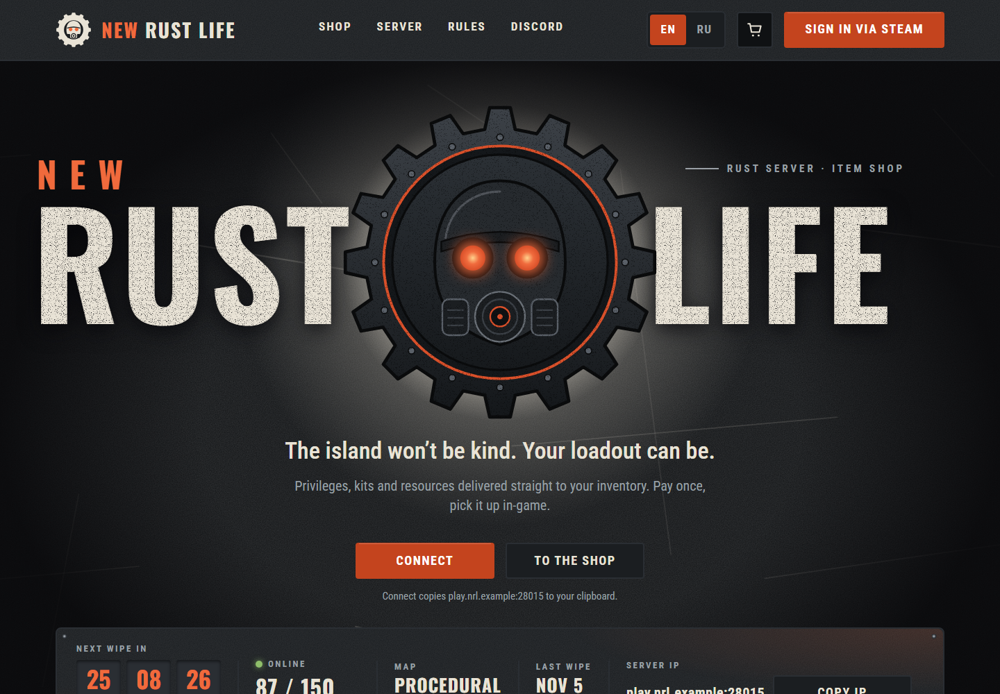
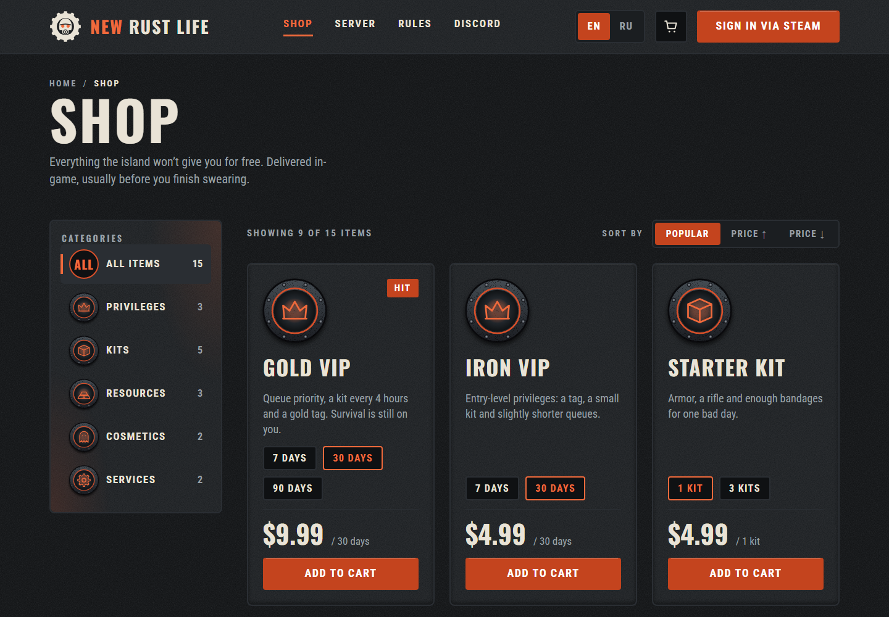
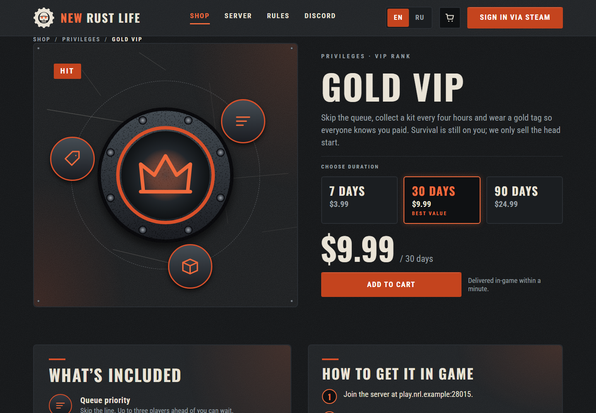
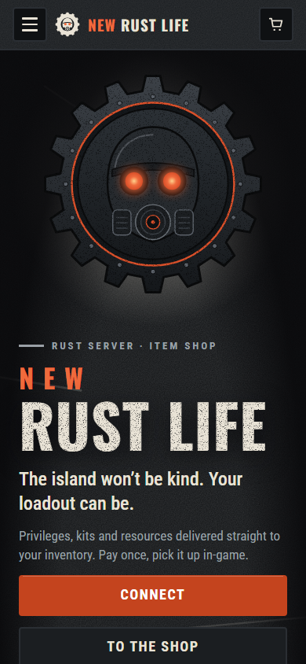
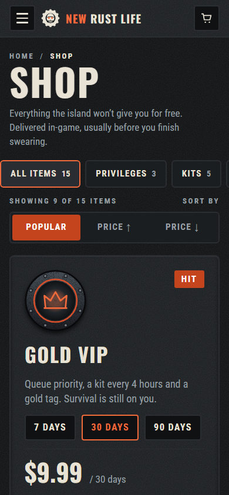

# NEW RUST LIFE — item shop concept

**English** · [Русский](#русский)

A clickable concept of an item shop for a Rust server: catalogue, product page, cart and a mock Steam sign-in, in English and Russian. Plain HTML, CSS and vanilla JavaScript. No build step, no trackers, no external requests.

> Fan-made concept. Not affiliated with Facepunch Studios or Rust. No real payments.



| Shop | Product |
|---|---|
|  |  |

| Home, mobile | Shop, mobile |
|---|---|
|  |  |

- **Live demo:** _link is added after publishing_
- **Figma:** _view-only link is added by the owner_

## What is clickable

- **Language EN / RU** on every page, remembered between visits.
- **Sign in via Steam (mock):** shows the profile “Wastelander_77” and a $12.50 balance; Sign out in the menu.
- **Shop:** filter by category, sort by price, Load more.
- **Product cards:** pick a duration or quantity (the price changes), Add to cart, Remove.
- **Cart:** quantity − / +, Remove, totals. Promo code `WASTELAND10` gives −10%; any other code shows an error.
- **Pay** is locked until you are signed in and accept the rules. It opens a demo confirmation (“Order placed — demo, no money taken”) and clears the cart.
- **Server block:** Connect and Copy IP copy `play.nrl.example:28015`; the wipe countdown ticks (first Thursday of the month, 19:00 UTC); online players drift by ±2 every 15 seconds.
- **Mobile menu:** burger, Esc to close, focus stays inside and returns to the burger.
- “Rules”, “Join Discord” and the footer info links are stubs and show a short notice.

## Run it

Download the zip (or clone the repo) and open `index.html` in a browser. It also works from any static host. The site uses hash routing (`#/shop`, `#/product/gold-vip`, `#/cart`), so no server configuration is needed.

## Stack

HTML, CSS (custom properties, grid, clamp), vanilla JavaScript in one global `window.NRL` namespace. State (language, sign-in, cart) lives in `localStorage` under `nrl:v1`; the page works if storage is blocked. Textures are CSS and SVG. Fonts are self-hosted: Oswald and Roboto Condensed (SIL OFL).

```
index.html
css/   tokens, base, textures, components, blocks, pages
js/    state, i18n, router, components, ui, actions, pages/
data/  products.js (15 products, EN + RU)
i18n/  en.js, ru.js
assets/ fonts, svg
```

## Credits and licences

Design & concept: **Vlyezko Studio**. Code: [MIT](LICENSE). Fonts: [SIL OFL 1.1](OFL.txt). Product names, copy and prices are invented for the concept.

---

## Русский

Кликабельный концепт магазина предметов для Rust-сервера: каталог, страница товара, корзина и условный вход через Steam, на английском и русском. Чистые HTML, CSS и JavaScript. Без сборки, трекеров и внешних запросов.

> Фан-концепт. Не связан с Facepunch Studios и Rust. Реальных платежей нет.

- **Живое демо:** _ссылка появится после публикации_
- **Figma:** _ссылку для просмотра добавит владелец_

### Что кликается

- **Язык EN / RU** на всех страницах, выбор запоминается.
- **Вход через Steam (условный):** профиль «Wastelander_77» и баланс $12.50; «Выйти» в меню.
- **Магазин:** фильтр по категориям, сортировка по цене, «Показать ещё».
- **Карточки товаров:** выбор срока или количества (цена меняется), «В корзину», «Убрать».
- **Корзина:** количество − / +, «Удалить», итоги. Промокод `WASTELAND10` даёт −10%, другой код показывает ошибку.
- **«Оплатить»** заблокирована, пока вы не вошли и не согласились с правилами. Открывает демо-подтверждение («Заказ оформлен, деньги не списаны») и очищает корзину.
- **Блок сервера:** «Подключиться» и «Копировать IP» копируют `play.nrl.example:28015`; таймер до вайпа идёт (первый четверг месяца, 19:00 UTC); онлайн меняется на ±2 каждые 15 секунд.
- **Мобильное меню:** бургер, Esc закрывает, фокус остаётся внутри и возвращается на бургер.
- «Правила», «Вступить в Discord» и информационные ссылки в футере — заглушки, показывают короткое уведомление.

### Запуск

Скачайте архив (или клонируйте репозиторий) и откройте `index.html` в браузере. Работает и на любом статическом хостинге: адреса вида `#/shop` не требуют настройки сервера.

### Авторы и лицензии

Дизайн и концепт: **Vlyezko Studio**. Код: [MIT](LICENSE). Шрифты: [SIL OFL 1.1](OFL.txt). Названия товаров, тексты и цены придуманы для концепта.
